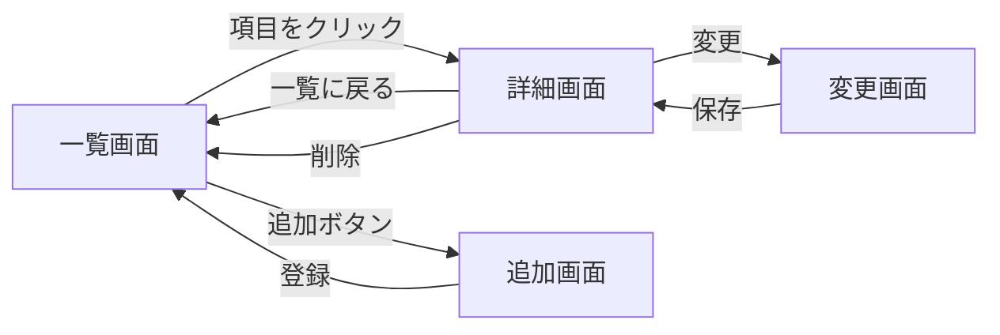
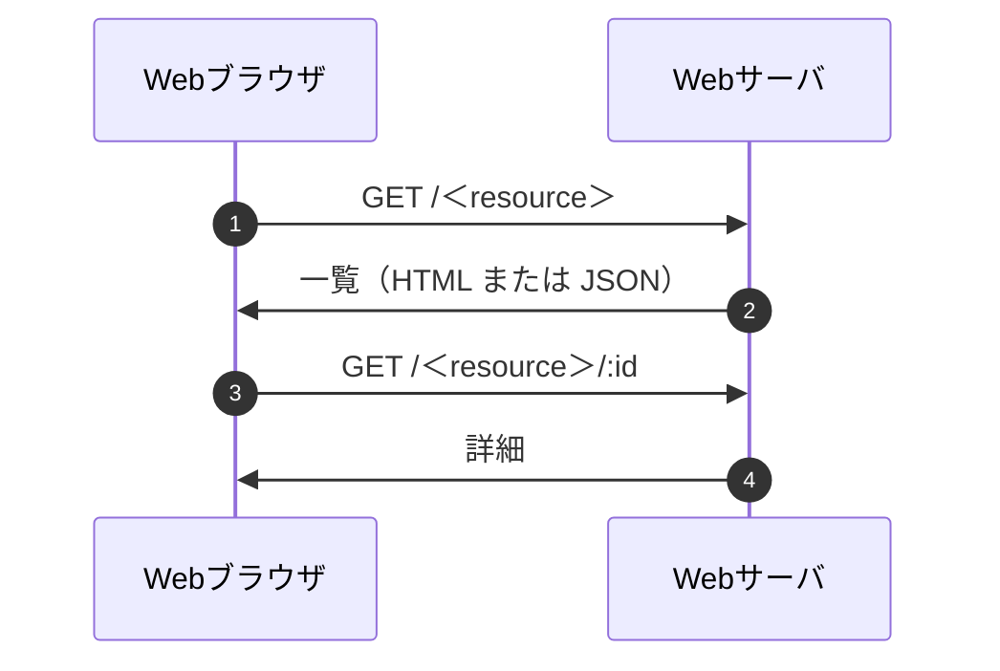

# 仕様書：＜システム名＞

- 科目：Webプログラミング
- 氏名：＜氏名＞　学籍番号：＜学籍番号＞
- 提出日：＜YYYY-MM-DD＞
- GitHubリポジトリ：＜https://github.com/＜ユーザ名＞/＜リポジトリ名＞＞

> 課題の条件（提出前に確認）
> - 京葉線システム以外に、一覧表示をベースとしたWebアプリを3つ開発する
> - REST APIで、データの一覧・詳細表示、追加、削除、変更を実装する
> - データは変数内に記録する
> - JSファイルの先頭に `"use strict";` を付ける
> - 仕様書は Markdown で、利用者向け・管理者向け・開発者向けの3部構成とする
> - ソースコードは GitHub に置き、このレポート内にURLを示す
> - 授業で説明していない技術は、概要と採用理由を記載する

## 0. システム一覧

| No. | システム名 | 扱うデータ | 起動ファイル | URL（ベース） |
|---|---|---|---|---|
| 1 | ＜例：本の管理＞ | ＜本＞ | ＜app_x.js＞ | `/＜resource＞` |
| 2 | ＜＞ | ＜＞ | ＜＞ | ＜＞ |
| 3 | ＜＞ | ＜＞ | ＜＞ | ＜＞ |

---

# 第1部　利用者向け

## 1.1 システムの概要
＜誰が、何のために使うシステムかを2〜3文で＞

## 1.2 できること
- ＜一覧を見る＞
- ＜詳細を見る＞
- ＜追加する＞
- ＜変更する＞
- ＜削除する＞

## 1.3 使い方
### システム1：＜システム名＞
1. ブラウザで `http://localhost:8080/＜resource＞` を開く
2. ＜操作の説明＞
3. ＜操作の説明＞

（システム2、3も同様に書く）

## 1.4 画面遷移

※ 実際の画面に合わせて修正する

## 1.5 注意事項
- データはサーバのメモリ上に保存するため、サーバを再起動すると初期状態に戻る
- ＜その他＞

---

# 第2部　管理者向け

## 2.1 動作環境
- Node.js：＜バージョン＞
- 主なパッケージ：express, ejs（`package.json` 参照）

## 2.2 インストールと起動
```
git clone ＜リポジトリURL＞
cd ＜フォルダ名＞
npm install
node ＜起動ファイル＞.js
```
- 待ち受けポート：＜8080＞

## 2.3 運用上の注意
- 初期データの場所：＜ファイル名・変数名＞
- データのバックアップ：＜変数内記録のため不可、など＞
- 障害時の対応：＜再起動の方法など＞

## 2.4 ファイル構成
```
＜フォルダ＞/
├─ app.js
├─ public/
├─ views/
└─ package.json
```

---

# 第3部　開発者向け

## 3.1 設計方針
- ＜なぜこの題材にしたか、どんな構成にしたか＞

## 3.2 データ構造（スキーム）

### システム1：＜データ名＞
| 項目 | 型 | 必須 | 内容・制約 | 例 |
|---|---|---|---|---|
| id | 数値 | ○ | 一意 | 1 |
| ＜項目＞ | 文字列 | ○ | ＜＞ | ＜＞ |
| ＜項目＞ | 数値 | | ＜＞ | ＜＞ |

```js
let ＜変数名＞ = [
  { id: 1, ＜項目＞: "＜値＞" },
];
```

（システム2、3も同様に書く）

## 3.3 REST API仕様

### システム1：＜データ名＞
| 機能 | メソッド | URL | 入力 | 成功時 | 失敗時 |
|---|---|---|---|---|---|
| 一覧 | GET | `/＜resource＞` | なし | 200 / 一覧 | ＜＞ |
| 詳細 | GET | `/＜resource＞/:id` | URLパラメータ | 200 / 1件 | 404 |
| 追加 | POST | `/＜resource＞` | ＜body＞ | 201 / 追加した1件 | 400 |
| 変更 | PUT | `/＜resource＞/:id` | ＜body＞ | 200 / 変更後の1件 | 404 |
| 削除 | DELETE | `/＜resource＞/:id` | URLパラメータ | 200 または 204 | 404 |

（システム2、3も同様に書く）

## 3.4 シーケンス図

※ 追加・変更・削除の流れも書き加える

## 3.5 ファイルごとの役割
| ファイル | 役割 |
|---|---|
| `＜app.js＞` | ルーティング、データ定義 |
| `views/＜＞.ejs` | ＜一覧画面＞ |
| `public/＜＞.js` | ＜クライアント側の処理＞ |

## 3.6 授業で説明していない技術
| 技術 | 概要 | 採用理由 |
|---|---|---|
| ＜例：＞ | ＜何をするものか＞ | ＜なぜ使ったか＞ |

（なければ「なし」と書く）

## 3.7 テスト
| No. | 操作 | 期待する結果 | 結果 |
|---|---|---|---|
| 1 | `/＜resource＞` を開く | 一覧が表示される | ○ |
| 2 | ＜＞ | ＜＞ | ＜＞ |

## 3.8 既知の問題と今後の課題
- ＜＞

---

# 参考にした資料
- ＜教科書・Webサイトなど（URLを明記）＞
